# 流量造假审核标准

[返回目录](../README.md) · [学城原文](https://km.sankuai.com/collabpage/1627666362?from=citadel_collabpage) · 已保存正文 · 2026-11-19

> 本篇已同步 15 张不同图片，无需学城登录；4 张未纳入本次 500 张同步范围。未能下载的图片已在原位置注明原因。[图片同步清单](../IMAGE_REPORT.md)。附件、音视频及思维导图保留原始链接。完整源数据见 [原始文件](../sources/%E6%B5%81%E9%87%8F%E9%80%A0%E5%81%87%E5%AE%A1%E6%A0%B8%E6%A0%87%E5%87%86.json)。

<h1 id="b-51d90e2fac154dc88255865e3b23d4d0">流量造假审核标准</h1>
<h3 id="b-28249c80ca294e4ca307aca255baa1f0">一、标签树</h3>
<figure src="https://km.sankuai.com/api/file/cdn/1627666362/191244401237?contentType=0&amp;isNewContent=false" width="158" height="317" id="b-ca66c76a44cd426f82f6d3f4ad698f95"><figcaption>思维导图：思维导图（原始链接，可能需要学城权限）</figcaption><a href="https://km.sankuai.com/api/file/cdn/1627666362/191244401237?contentType=0&amp;isNewContent=false">在原文服务中查看</a></figure>

优化台账

<table id="b-11f770581b924b818972341dbbf628e3">
<tr id="b-c2a97aa575584fb18d89ec7e3c1e5efc">
<th id="b-b9899ff78238407a994c9356cd3f7b4e">

优化时间

</th>
<th id="b-2f6b9428b663448493eddfbd2db18754">

原标准

</th>
<th id="b-192dbfb0b2bf4446aa34218be78f80ea">

优化标准

</th>
</tr>
<tr id="b-a9524ce27f6e4c8386ef58e7cd79946a">
<td id="b-306962d477ed4556b70e5cae327d5112">

11.1218点31

</td>
<td id="b-2c6b9197432f4d6aaf986f5019c178f3" style="vertical-align:top">

【图/视/文/音】

打标

1、出现明示要求用户修改评价的

修改评价

修改评价内容、评价星级、评价分类等

2、内容提及点评行为（差评、评价、反馈、诉求等）并关联暗示话术

暗示话术（可泛化）

给个机会、高抬贵手、帮帮忙吧、沟通一下等

<strong>不打标</strong>

<ol id="b-606316ea097444ada2ee32ea478d69eb">
<li id="b-06f148aadb5e4ec68621c52adf88e0e7">

用户自行修改评价

</li>
<li id="b-c8426555b925454e9ddca2b8ba3e10da">

用户反馈商家有要求修改评价行为

</li>
<li id="b-97f2e36d864a4bfb8888509faf0a056f">

要求删除个人形象照片的内容

</li>
</ol>
</td>
<td id="b-f10e524cb40f4a45af6e020b00c994f0">

【图/视/文/音】

打标

1、出现明示要求用户修改评价的

修改评价

修改评价内容、评价星级、评价分类等

2、用暗示话术明确引导用户修改评价：提及点评行为并关联暗示话术

点评行为（可泛化）

差评、评价、反馈、诉求、星级

暗示话术（可泛化）

给个机会、高抬贵手、帮帮忙吧、沟通一下、商量一下、处理一下

<strong>不打标</strong>

<ol id="b-b66047cdd33246c2a2210c8cb2c4f773">
<li id="b-0577c6ed5d1b4f1da61c01c05132dbc8">

用户自行修改评价

</li>
<li id="b-9557eab5d816456faa7a68cce805650b">

用户反馈商家有要求修改评价行为

</li>
<li id="b-230c884dcfcb4de4883e95f4552c908e">

要求删除个人形象照片的内容

</li>
</ol>
</td>
</tr>
<tr id="b-1785782936ac428197bc272b798b1f8c">
<td id="b-e90ef3f387804c5eb6073ebeb64f3eb1">

11.5日18点

</td>
<td id="b-ce34526510414131b99b6438593a4b2c">

【图/视/文/音】

<strong>打标（仅管控线上）</strong>

1、写点评/笔记/评价<strong>且</strong>出现可以获取利益的描述。

<ul id="b-cc1074a7341f4c4ab5a374dc19b12552">
<li id="b-efa1141de04d45fb8f4aea85d929b1d7">未写评价时，商家承诺可给利益或已给利益以此诱导评价。</li>
<li id="b-a9fbc2bdfcc84ec7b451e45864a02e56">已写<strong>好评</strong>时，商家主动返送利益。</li>
</ul>

利益

<ul id="b-d59e8ddc59f54ff0a21c399676eda0e6">
<li id="b-aa878a7f080649f6a912b8cbca912348">

直接返现

</li>
<li id="b-ddcf5173adb94e878e3b3bc3fefa57f3">

给予红包或优惠券等变相返现

</li>
<li id="b-df21496af87c44fa91a533828f3a1cf0">

赠送产品、服务等其他利益方式

</li>
<li id="b-fb5ba8b759004a47bcd1e2a195dbf8cc">

体验或试吃

</li>
</ul>

2、内容出现提供好评服务或好评交易信息的。

好评服务或交易（可泛化）

合作点评，接好评单，评论任务，评价佣金，有偿评价等

3、内容出现商户邀请用户体验或试吃关联<strong>互免</strong>的。

4、内容出现有针对性地邀请等级较高的用户免费体验或试吃。

等级较高

<ul id="b-5a408a5a760e4c3ba98f4ebe88357c2c">
<li id="b-5e6eb79f4ad94a68be71f1e76d97644b">

直接描述等级很高/较高

</li>
</ul>
<ul id="b-02e76ea3ab67436b9cce1524d705f581">
<li id="b-87065463372342aba3859dfbe404eb4e">

提及大V、LV等级如V1、V2..V(n)等。

</li>
</ul>

<strong>不打标</strong>

1、商家求评价，无任何利益交换的内容。

2、用户询问/质疑，写点评/笔记/评价+利益交换的内容。

3、用户表达对商家在商品质量、服务水平、经营方式等方面的不满时，出现点评/笔记/评价+利益交换信息。

4、大众点评和美团官方发布写点评、写笔记、写评价的利益获取活动。

<ul id="b-4d180cc05b944b9683e392d0c3b6440f">
<li id="b-4c1ebab3fc5e4e68bb2c43c5c5020536">在美团/大众点评APP首页、评价页面等官方页面发起的活动。</li>
<li id="b-a1b164a5da1e47ebbfaf8470a076e8a3">在笔记达人中心官方发起的创作活动。</li>
<li id="b-27ab3ad16385432b84730cf4f20ba5fb">

出现官方关键词

</li>
</ul>

     业务类：

     神枪手、特价团、拼好饭、美团外卖

     点评类：

     神券节、超值券包、本地大牌节、城市向导官

</td>
<td id="b-541d2bcf57c94286b4ccae2b2bf81f68">

【图/视/文/音】

<strong>打标（仅管控线上）</strong>

1、写点评/笔记/评价<strong>且</strong>出现可以获取利益的描述。

<ul id="b-5c784abe5dec4f45a3c1408ffbe46e0b">
<li id="b-c911d3194f7e406199baa202d9e0e4be">未写评价时，商家承诺可给利益或已给利益以此诱导评价。</li>
<li id="b-df2d37acf4df48a4a18076af0c861062">已写<strong>好评</strong>时，商家主动返送利益。</li>
</ul>

利益

<ul id="b-be413499016b4426a355b025942eb1fc">
<li id="b-0a598d7cddb54e3d8e7f833bf75f6ec9">

直接返现

</li>
<li id="b-5fa8d0e01c5f4217bcff045ead6b5817">

给予红包或优惠券等变相返现

</li>
<li id="b-1a30e40fa0184edd8558cb165497cd3a">

赠送产品、服务等其他利益方式

</li>
<li id="b-8ebc41dad1474742b2e6e6d8d5970809">

体验或试吃

</li>
</ul>

2、内容出现商户邀请用户体验或试吃关联<strong>互免</strong>的。

3、内容出现有针对性地邀请等级较高的用户免费体验或试吃。

等级较高

<ul id="b-caa97b23a1e54b819c9e76b197405cbe">
<li id="b-aab3d7d1fa4045c7b015575bebd787e0">

直接描述等级很高/较高

</li>
</ul>
<ul id="b-9ddcb58581504ba581572e01a0098738">
<li id="b-29e481f867524226b062e40a5ff0ff31">

提及大V、LV等级如V1、V2..V(n)等。

</li>
</ul>

<strong>不打标</strong>

1、商家求评价，无任何利益交换的内容。

2、用户询问/质疑，写点评/笔记/评价+利益交换的内容。

3、用户表达对商家在商品质量、服务水平、经营方式等方面的不满时，出现点评/笔记/评价+利益交换信息。

4、大众点评和美团官方发布写点评、写笔记、写评价的利益获取活动。

<ul id="b-0594d7a7f51c44c7b88eac3ea5830eb9">
<li id="b-f56f1209e4aa496fa69f8a657434c5b0">在美团/大众点评APP首页、评价页面等官方页面发起的活动。</li>
<li id="b-d39a5052199f4c74b00b0517abaa9fbb">在笔记达人中心官方发起的创作活动。</li>
<li id="b-b62b77226db34f768f70800305f9e636">

出现官方关键词

</li>
</ul>

     业务类：

     神枪手、特价团、拼好饭、美团外卖

     点评类：

     神券节、超值券包、本地大牌节、城市向导官

</td>
</tr>
</table>

<h3 id="b-7082436980a34bb2966488436e71d6e3">二、标准value</h3>
<table id="b-33735d03e17e4be3822969ec32736d5c">
<tr id="b-2cb036dca5084b80ace701c30e581093">
<th id="b-9e27245c72864613bfbccf5257a201cc" style="vertical-align:middle">

</th>
<th colspan="3" id="b-8359a0195d874218ab32c39ca978609a" style="background-color:rgb(246, 246, 246);vertical-align:top">

<strong>V3标签体系</strong>

</th>
<th rowspan="2" id="b-06c0cd92c1e34b2ca50f85e0204f228b" style="background-color:rgb(246, 246, 246);vertical-align:middle">

<strong>风险点</strong>

</th>
<th rowspan="2" id="b-722971b4dd3948ebaf5a873c16e0c8b4" style="background-color:rgb(246, 246, 246);vertical-align:middle">

<strong>细则和具体定义</strong>

</th>
<th rowspan="2" id="b-b31886c8584042788cccb3c56808c3c4" style="background-color:rgb(246, 246, 246);vertical-align:middle">

<strong>文字样本</strong>

</th>
<th rowspan="2" id="b-6844a24d780f437baefc7b3876e8d284" style="background-color:rgb(246, 246, 246);vertical-align:middle">

<strong>图片样本</strong>

</th>
<th rowspan="2" id="b-b1b16cecb0d94565b90910d6b6e94e2f" style="background-color:rgb(246, 246, 246);vertical-align:middle">

<strong>豁免样本及备注</strong>

</th>
</tr>
<tr id="b-8ce2599ce3854f62a6d91f24a9d1d5e7">
<td id="b-8994360f774e4954ac31330bdf911977" style="vertical-align:middle">

</td>
<td id="b-cfc71d4507d8463bbeba5302bd8ac526" style="background-color:#F4F5F7;vertical-align:top">

<strong>一级标签</strong>

</td>
<td id="b-ddab3192f6c34eed993adc61c3b8a933" style="background-color:#F4F5F7;vertical-align:top">

<strong>二级标签</strong>

</td>
<td id="b-109130e7941b41e6b8e7a8598c502ceb" style="background-color:#F4F5F7;vertical-align:top">

<strong>三级标签</strong>

</td>
</tr>
<tr id="b-c88f5f8f823d409fb409bd5ddf0f81cd">
<td id="b-f5a3ff126e39487a8956e5ce36faf061">

</td>
<td rowspan="4" id="b-0a07c159b7df4e9285439f50ace11b57" style="vertical-align:top">
<h2 id="b-0e678dd824754ea5bb689c159e38f5c7" style="text-align:center">流量造假</h2>
</td>
<td rowspan="4" id="b-9e5a440f5c3c4579a7d96e16914cb001" style="vertical-align:top">
<h3 id="b-9bb61971a1764e07ab1f78da39e35b7c" style="text-align:center">诱导互动</h3>
</td>
<td id="b-153a01126f97477781ff5fa8700e0dec" style="background-color:rgb(232, 241, 255);vertical-align:top">
<h4 id="b-3fbcd4e73dfd4d26b8d07e2663f208e5" style="text-align:center">引导互动</h4>
</td>
<td id="b-6d7bcdf57bcd41d69d47f356f4b7513d">

通过发布大量“互粉互赞”回应的方式吸引人为其点赞，提升自身关注度，以此达到升V或其他广告目的。

</td>
<td id="b-47bf9e3b086149b58aa1d06cfdec92ca" style="background-color:rgb(255, 255, 255);vertical-align:top">

<strong>打标</strong>

【图/视/文/音】

<ol id="b-04c6920a9c8e4a23862bdc16387b34e3">
<li id="b-a10185f1d1aa479d892edbced3b40cad">

以引导他人点赞或点关注为目的，内容出现语境明确的<strong>互粉互赞/刷粉刷赞话术</strong>及其变体信息。

<strong>互粉互赞/刷粉刷赞话术（可泛化，适用于</strong><strong>定义1</strong><strong>）</strong>

<table id="b-b7f29b78778c427f9913175fcde3f2c5">
<tr id="b-12877533bad94fddbdfe934f89852550">
<th id="b-d79a06ca6862421f89fe88b36f2596b5">

类型

</th>
<th id="b-8ac0102c3f644b4d8af31e62f6f27016">

内容

</th>
</tr>
<tr id="b-2bf0656d8cd74d83ae4e6470bba06cf0">
<td id="b-aadc35014bf047b696dd63d06dc6299f">

互粉/刷粉

</td>
<td id="b-71587cd769c64c079ddaf47ff1534064">

回粉、互粉、粉必回（粉笔灰）、回关、互关

</td>
</tr>
<tr id="b-1b74533ec6654f918a426c478d529418">
<td id="b-1e2e159dd2ce4af6a2f021ed013634b5">

互赞/刷赞

</td>
<td id="b-a5fcf5e4cea1433f9cf8f1d4de863e9b">

送赞、回赞、互赞、赞必回

</td>
</tr>
<tr id="b-c7e3845d32f9470aa6c649a4d6f1933a">
<td id="b-349077187bbe4447b77ba614a3b54c69">

互动

</td>
<td id="b-736f7032aa2c452498b0d92c3983e617">

回访、互动、互踩、双向奔赴、礼尚往来、常来常往、双向、互串/🍢（串的表情包）

</td>
</tr>
<tr id="b-f039bbda66724dcf98dfffba0add0e00">
<td id="b-082c2c6ff3fd47c88f84eb5440f5efbc">

代表“互”含义的表情包

</td>
<td id="b-3cd600ef3fb243d5bc0df420ed3b6679">

、🐯、🦋等

</td>
</tr>
</table>

</li>
<li id="b-f22c9950e12a40c1b9eb2a4a4dde8080">

内容出现<strong>疑似刷粉刷赞关键词</strong>且关联<strong>点赞动词/表情</strong>/数字

<strong>疑似刷粉刷赞关键词（不泛化</strong><strong>，适用于定义2</strong><strong>）</strong>

点赞、串门/窜门、来访/拜访、交朋友

<strong>点赞动词（不泛化</strong><strong>，适用于定义2</strong><strong>）</strong>

送、奉、给、+、补齐、打卡

<strong>表情（可泛化</strong><strong>，适用于定义2</strong><strong>）</strong>

<table id="b-d6e15c6775ed446687957da365fa6992">
<tr id="b-bf1fee7b12b14a9fb4af54dfe9e503f9">
<th id="b-b0fa85485c294ceb802bbe1afa33bb6c">

类型

</th>
<th id="b-b19a4532db1c424faf805e3b41eaa31e">

内容

</th>
</tr>
<tr id="b-6f1c6d22bf104256bdde67d7c6d39895">
<td id="b-81979f6c8a6b4df595ea5540b89218fe" style="vertical-align:middle">

“赞”和“关注”变体为表情包

</td>
<td id="b-38b76e4fb9814a7e90e053825a4c8fdf">

👍、[强]、❤、[ 爱心 ]、小心心、💗、🌟、⭐等

</td>
</tr>
</table>

</li>
</ol>

<strong>豁免</strong>

【图/视/文/音】

<ol id="b-4f85c720a48f4119b3670425a7825f70">
<li id="b-ad7fa3f0bbf743eaa60fb59f2b91a244">

出现点赞、串门/窜门、来访/拜访、​交朋友、打卡行为未要求互动的。

</li>
<li id="b-0fe422874d764e1e862b7310c907262b">出现"点赞"词汇关联“👍”表情包，无其他刷粉刷赞关键信息。</li>
<li id="b-9989001376ce4b8cb03f8b642f3cc0c2">教授如何提高曝光度，提及多与别人互动</li>
<li id="b-073dcffdc95a4490914c75b9a7a3b3b4">

客观提及或系统通知中涉及<strong>互粉互赞/刷粉刷赞话术，</strong>非以引导他人点赞或点关注为目的

<strong>互粉互赞/刷粉刷赞话术（可泛化，适用于</strong><strong>定义4</strong><strong>）</strong>

<table id="b-ed8b22b9a57d4498b62e9499338f6645">
<tr id="b-e26ecc4921dd407da2653d0e8c77d6b7">
<th id="b-0d5b4826734d4dd5b5a6df324f7759e2">

类型

</th>
<th id="b-2dcdfa67ccd6423b9d5339e6218c802a">

内容

</th>
</tr>
<tr id="b-85d3fabc60364bf7a2a37ead308eaa95">
<td id="b-11bc0209a40b458986dea0f30a0155f2">

互粉/刷粉

</td>
<td id="b-8d28581eec264ccdb06111406571a54b">

回粉、互粉、粉必回（粉笔灰）、回关、互关

</td>
</tr>
<tr id="b-c3c84be989274a33b92fd1fdc7d17f99">
<td id="b-31854fa3a1c044bf9205ff5f96d98161">

互赞/刷赞

</td>
<td id="b-c8e6d48e021a4975b36084c435b5c9ec">

送赞、回赞、互赞、赞必回

</td>
</tr>
<tr id="b-a218ea99b6cf445585cce1661f3c6319">
<td id="b-df1b99b57ed7447fbb0d6d4131fb7700">

互动

</td>
<td id="b-eee324e98bae44ba80f8c93f1c5b2646">

回访、互动、互踩、双向奔赴、礼尚往来、常来常往、双向、互串/🍢（串的表情包）

</td>
</tr>
<tr id="b-d3435bd1dff3457bba6749c622fa89c9">
<td id="b-51ccff20a8054ecf937c702b7b561a51">

代表“互”含义的表情包

</td>
<td id="b-fded048f744d42ac8b90fd48009723b7">

、🐯、🦋等

</td>
</tr>
</table>

</li>
</ol>
</td>
<td id="b-48818ee4f3534c78835c8b58490ed24d" style="background-color:rgb(255, 255, 255);vertical-align:top">
<ol id="b-f55e52bb40994fab8988db59282de141">
<li id="b-9ab215167479402d9849625628ff5be0">

内容出现语境明确的<strong>互粉互赞/刷粉刷赞话术</strong>及其变体信息。

案例

<table id="b-205064536b31465d857b71a593226499">
<tr id="b-e170046c9ab74cff9f4d6008feccba30">
<th id="b-c63072898d014b99963b8f13461fada4">

类型

</th>
<th id="b-29593e6274fb4119a0a918b05cf4a7d0">

内容

</th>
</tr>
<tr id="b-d6933060bc0945eaafae5eb35af96455">
<td id="b-5a6203a742da48879d9503fa7d3e588e">

互粉/刷粉

</td>
<td id="b-4009be7fe46d4148a1dcbc846b4f161f">

互相关注串门～

互串互串

有空记得回赞回粉哦[爱心]

前排，欢迎回关

666，收藏，欢迎回关

FEN呀ZAN

hu[强]hu粉

🐯粉

</td>
</tr>
<tr id="b-004d882d707547b3afbad9587e57b332">
<td id="b-026d529c5e7b4674bf5dc7d2c172c0ec">

互赞/刷赞

</td>
<td id="b-7716bd92de7e48c88fb53cd3fca23a71">

回赞15➕

回赞回评呗～～

ᵕ̈🧡ᵕ̈💚ᵕ̈💙ᵕ̈🤍ᵕ̈💜ᵕ̈💛ᵕ̈ 来访送赞欢迎新朋友互 ᵕ̈🧡ᵕ̈💚ᵕ̈💙ᵕ̈🤍ᵕ̈💜ᵕ̈💛ᵕ̈

送30赞，回粉[呲牙]

欢迎回赞

送👍，回👍谢谢！

晚上好，已点赞10+

送👍

🐯赞

点赞有礼

</td>
</tr>
<tr id="b-1a84dd579cc44e628d2d886f7dd65306">
<td id="b-5ff79b4e96ff450692808ecca5969759">

互动

</td>
<td id="b-09ba0fb70bd64c799f3853b2e3591813">

晚上好，我来互动啦

我盼星星盼月亮.可算把你等来了，以后可以多多互动[礼花]

打卡问候☝️欢迎👏互动

呼，经典，踩一下 你不要跑堂哟

欢迎回访

周六格格来串门，常来常往哦

感谢关注 串门回礼 欢迎回访[ 礼物 ] 

🐹仓鼠， 来打卡回访串门交朋友咯

2️⃣0️⃣💛💚💜补齐 期待回访[爱心]💖哦

回访30❤

上午好 回访10 奉上10 祝你生活愉快

</td>
</tr>
</table>

</li>
<li id="b-7eebdc7997294b2790b8d2bf8620ea2c">

内容出现<strong>疑似刷粉刷赞关键词</strong>且关联<strong>点赞动词/表情</strong>/数字

案例

串门送❤

我来串门儿了，给30个赞

来访新朋友+20[爱心][握手]

今天来串门啦，10颗小🌟送上，等你来哦

晚上好！日常窜门，奉上10小⭐⭐

带着小心心20❤来串门儿

周末愉快美女，奉上50+星星来串门啦[玫瑰]

5.3🐹仓鼠小姐姐来串门打卡啦 送达❤10

一打小[爱心]💖来补齐喽 等你来串门吧💛💚

登门拜访[爱心][爱心][爱心]

10+交新老朋友

早安 串门 ➕  150

✨💗来串门啦～❗️💗20

串门来啦！一[ 强 ]到底

10[ 爱心 ]串门，滴滴[ 玫瑰 ]

4.22来串门，👍🏻赞❤10+，期待互互互喔[玫瑰][玫瑰]

串门看朋友赞十，十全十美[亲亲][亲亲][亲亲]

</li>
</ol>
</td>
<td id="b-84835ce79820415785a321f344378928" style="background-color:rgb(255, 255, 255);vertical-align:top">
<ol id="b-4dcdcb7eaf8747c29daa8f910c5d6c0e">
<li id="b-bd232b8f8e184f838008463bbc3b3b0a">

内容出现<strong>疑似刷粉刷赞关键词</strong>且关联<strong>点赞动词/表情</strong>/数字

案例

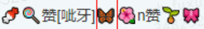

</li>
</ol>

​

</td>
<td id="b-bec2456292d1483683d278a8b059315b" style="background-color:rgb(255, 255, 255);vertical-align:top">
<ol id="b-f2779226a2a544eaaeff572a0731cfb3">
<li id="b-ed6b9806b0034dbd9955020c07d2f7b9">

出现点赞、串门/窜门、来访/拜访、​交朋友、打卡行为未要求互动的。

案例

<ul id="b-c1b49140c62e4a3e9d61beb4c63e3875">
<li id="b-03778e4319dc482e8d517a9e38e40938">赞</li>
<li id="b-c67c17df6a2e46e899cfaaf121b6a464">

串门

</li>
<li id="b-ef30420987af47ba81c54adce823db8b">

晚上好(✪▽✪) 串门看看您[呲牙][调皮] ～～

</li>
<li id="b-c09628af18d34c91b180f3e027731d61">

huhu~

</li>
<li id="b-22d907d448554dd98ad53ea939fba2cd">

Huhu~666~

</li>
<li id="b-d3f2d4d9178e45eb9328a002a1c14feb">

[强]

</li>
<li id="b-6b1ca4b79d8f4858981d423f555938c5">来库尔勒 都看见兄弟的打卡啦👍</li>
<li id="b-45ad4205ed3d45c1a6d322ff0c51d661">吃了打卡套餐 👍 </li>
<li id="b-a43fb7eadd1646629e9135557b756441">这个发型很漂亮，为你点赞👍</li>
<li id="b-f49b4e9aa8fa43dca9acd5fbb5e1dd75">互</li>
<li id="b-8b3000b4f6ab43c3ab48f9837f297386">互互互互互互互互</li>
</ul>

</li>
<li id="b-8ba92693423b473aa92a6c0a11d9d5bb">

教授如何提高曝光度，提及多与别人互动

案例

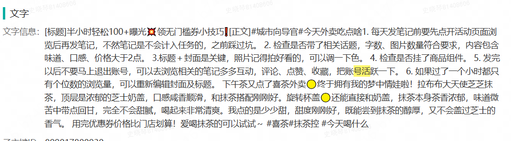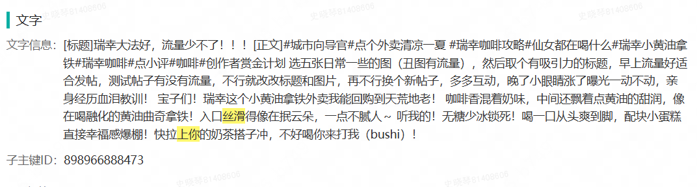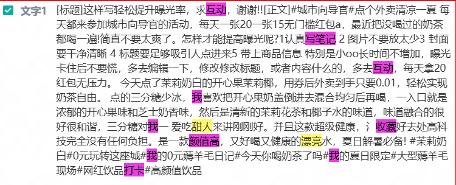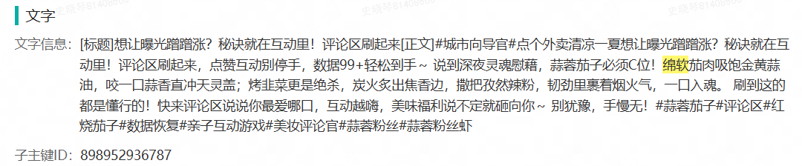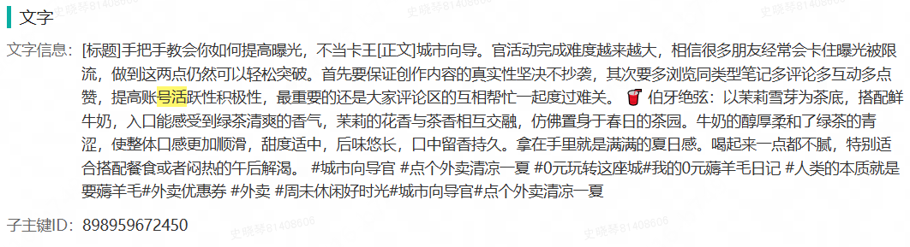

</li>
<li id="b-b643fd578a13443bbd7936b12c7dcc16">

客观提及或系统通知中涉及<strong>互粉互赞/刷粉刷赞话术，</strong>非以引导他人点赞或点关注为目的

案例

<ul id="b-34f2b33d8b7d4e63924103715caa343b">
<li id="b-83fa56cd11ca417a8bf8ae8a204d7507">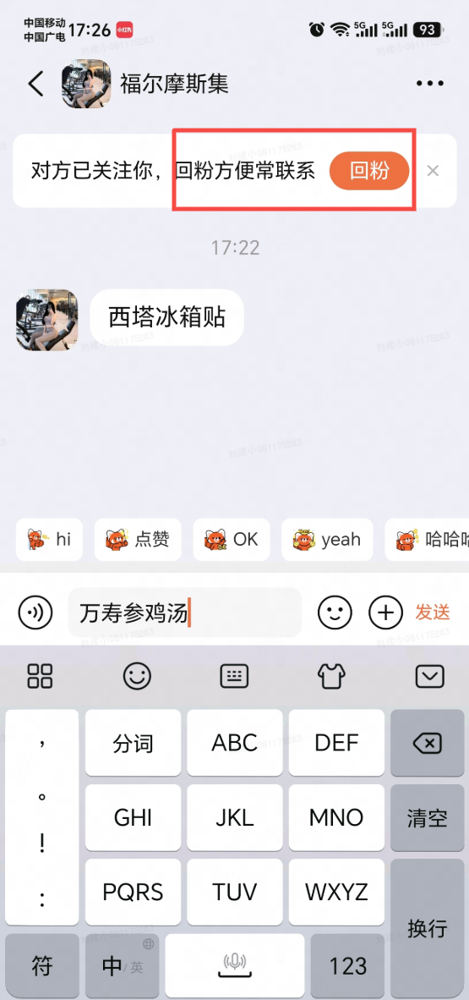</li>
</ul>
<ul id="b-8b278700d53f46d18837b8eadc0e800e">
<li id="b-93ab02f6a9904002b9852654dedca950">我们认识呀，很早就互关了</li>
</ul>

</li>
</ol>
</td>
</tr>
<tr id="b-a490119ebdae4509ba76a51a5fed1722">
<td id="b-5a94ee464ede49cb8d95bf0d5fe01161">

</td>
<td rowspan="2" id="b-9dbf9d911bbe4e03921ba59a58c702e9" style="background-color:rgb(250, 225, 235);vertical-align:top">
<h4 id="b-60852d57be57469c96769276170c60de" style="text-align:center"><strong>虚</strong>假评价</h4>
</td>
<td id="b-a591c0aa0ceb4536aef1e6dd0abc9cd8">

买卖好评

</td>
<td id="b-c1e9938921d341b895dfcd34dd17e475" style="background-color:rgb(255, 255, 255);vertical-align:top">

<strong>打标（仅管控线上）</strong>

【图/视/文/音】

<ol id="b-95ef8194fe4e427dadcf863d0642d3af">
<li id="b-be2fa07f4cf84ff59cef7bbd76b41220">

写点评/笔记/评价且出现可以获取<strong>利益</strong>的描述。

<ul id="b-6acc24d7856244d58d16841101a9f846">
<li id="b-dae71561d76f4526a637b51a08108dfd">未写评价时，商家承诺可给<strong>利益</strong>或已给<strong>利益</strong>以此诱导评价。</li>
<li id="b-5bebf0d981ad4fbfa5d65671627cf551">已写好评时，商家主动返送<strong>利益</strong>。</li>
</ul>

<strong>利益（适用于定义1）</strong>

<ul id="b-adcd8a81fd8c40e5bb8205c6b63bc5e8">
<li id="b-5c9561c7d72e4bd8b6c3d2f346149a4b">

直接返现

</li>
<li id="b-77d2140b9346406d950fb795e2c1f16c">

给予红包或优惠券等变相返现

</li>
<li id="b-6bba6b8e81a6416c8ca65d95bfc0643c">

赠送产品、服务等其他利益方式

</li>
<li id="b-c695df2dc7f345f68b913669fa4aaaba">

体验或试吃

</li>
</ul>

</li>
<li id="b-90864a51b7e34460a51ed682983aeeb9">内容出现商户邀请用户体验或试吃关联互免的。</li>
<li id="b-14731e54458848098fd8a9bf8665bcc9">

内容出现有针对性地邀请<strong>等级较高</strong>的用户免费体验或试吃。

<strong>等级较高（适用于定义3）</strong>

<ul id="b-9a0ec6738ab548c4955c83fe295cfe0d">
<li id="b-5afdec8051744c1da3767aa588d90734">

直接描述等级很高/较高

</li>
</ul>
<ul id="b-e5b947a55cb24cd394900f76ca1584f4">
<li id="b-fc980ff9a6dc4d9282887df096b37b84">

提及大V、LV等级如V1、V2..V(n)等。

</li>
</ul>

</li>
</ol>

<strong>豁免</strong>

<ol id="b-20b94ac4f398465eb39cd15ed0f31921">
<li id="b-7d53f44d9f624305ab6812df3e2178a1">

商家求评价，无任何利益交换的内容。

</li>
<li id="b-5306d8fe3b2e401ca4c4237f856e0c49">

用户询问/质疑，写点评/笔记/评价+利益交换的内容。

</li>
<li id="b-353ff4c83517463b88bbc627284d9eb0">

用户表达对商家在商品质量、服务水平、经营方式等方面的不满时，出现点评/笔记/评价+利益交换信息。

</li>
<li id="b-e2aea77e6cca44c5a4f8b418c1030590">

大众点评、美团和其他三方平台官方发布的官方发布写点评、写笔记、写评价的利益获取活动。

</li>
</ol>
<ul id="b-10f2676020e54023968d048b6904a6c0">
<li id="b-e414632a404c447f802675718d588201">

在美团/大众点评APP/其他三方平台首页、评价页面等官方页面发起的活动。

第三方平台（可泛化，适用于定义4）

淘宝、天猫、天猫超市、淘宝闪购、饿了么、盒马优选、盒马、盒马鲜生、闲鱼

京东、京东超市、京东外卖（京东秒送）、京东到家、京东视频、七鲜

抖音、西瓜视频、火山引擎、火山小视频（抖音火山版）、今日头条、抖省省

拼多多（PDD）、多多买菜

微博、微信、企业微信、微信公众号（公众号、服务号、订阅号）、微信小程序（小程序）、微信短视频（视频号）、QQ、微视

快手、小红书、口碑网、百度糯米、携程、马蜂窝、去哪儿、飞猪、新氧、58同城、彩贝壳、更美、悦美、联联周边游、美惠点评、心优选、每日优鲜、果多美、多点、小影、美拍、美味不用等、享库、VUE

</li>
<li id="b-4c7882725d3242cb8db114c3bd60a73e">在笔记达人中心官方发起的创作活动。</li>
<li id="b-c4527d86ee97457dbe50620250d88819">

出现<strong>官方关键词</strong>

<strong>官方关键词（适用于定义4）</strong>

业务类：

神枪手、特价团、拼好饭、美团外卖

点评类：

神券节、超值券包、本地大牌节、城市向导官

</li>
</ul>

5. 无需执行type：10447、20358、40035

审核无需执行队列

机审质检：

机审质检SJ_点评定制专审 机审质检SJ_交互信息_10447生态

机审质检DX_交互信息_10447_生态

机审质检DX_交互信息_10447

人审（及对应质检）：

【生态】25min通用审核点评-定制专审21601

【生态】25min通用审核-点评-星级用户定制专审(id: 24437)

</td>
<td id="b-f49a757b5db446b5ad63f8e7edf310a1" style="background-color:rgb(255, 255, 255);vertical-align:top">
<ol id="b-1cda09eea4434ae49d9884692423ebf1">
<li id="b-2003164164d144e09d91ff6a44e04ebc">

写点评/笔记/评价且出现可以获取<strong>利益</strong>的描述。

案例

<ul id="b-6852c53a236143829076be125c5da771">
<li id="b-27ad7ac6a55e4958bc992cd00f3968fd">我是做婚纱摄影的，想让<strong>体验</strong>一下，给个<strong>好评</strong></li>
</ul>
<ul id="b-01f58e157dbe45ddbe58dc278b5f675c">
<li id="b-908118d56e6b477fa3ba9c306a9a64b6">您好，我们是东田造型，浦东嘉里城店 。因浦东嘉里城店开业8周年店庆，每周特约3位颜值在线的小姐姐，免费<strong>体验</strong>技术总监，洗吹造型，服务一次。 服务完成后需要您配合我们的发型师，拍发型效果图，帮我们在您的点评上账号上<strong>写个好评</strong>如有兴趣➕微信号:DAzaoxing东田造型，嘉里城店。 期待您的光临！！</li>
<li id="b-87cf17f4664345c6b0176a282e5bb20c">老板你好。麻烦给个五星<strong>好评</strong>呗。下次小店可<strong>免费赠送</strong>汤品哦！感谢。</li>
</ul>
<ul id="b-553a07dd56f741c9af380f055bbf14cd">
<li id="b-24b5dcac451140eba4add015f4620560">感谢您对本小店的支持与鼓励，添加本小店微信，<strong>带图好评送优惠券</strong>，平台下单不限消费送统一系列饮料一个！</li>
<li id="b-457249b443354794a23af9d66e1971ca">非常感谢您的五星<strong>好评</strong>，并于后台给您发放2元<strong>优惠券</strong>！祝您好人一生平安！全家幸福安康！</li>
<li id="b-03b65618c22d4bf184b7bc455cf84599">谢谢亲的<strong>五星好评</strong>，祝您及家人身体健康。<strong>优惠券</strong>已送哦</li>
</ul>

</li>
<li id="b-349b9ff571f343e7880e9be7403333dc">

内容出现商户邀请用户体验或试吃关联互免的。

<ul id="b-d292718562f64af2b9fc9442c0eb2451">
<li id="b-903ebcaecf284f50bef91c2e30be02f5">您好可以好评互免吗</li>
<li id="b-34bf59ff05724dbe80866b01b9e89996">邀请你到我们店做头发互勉</li>
</ul>
</li>
<li id="b-f901759602fc4f9cb7603a6832c1002e">

内容出现有针对性地邀请<strong>等级较高</strong>的用户免费体验或试吃。

<ul id="b-e49230e85f0b418398e933329f03cbcb">
<li id="b-e9f8287ead24423ea05fa2a9383bcf0f">在么 美女 看见你的大众点评号等级很高 需要做头发么 免单 染发剪发都可以 按这你的需求来 全免单 我是三里屯太古里北区toniguy（太古里店 ）的造型师 剪发价位380 一个月公司只给两个免单名额做大众点评 有需要的话➕微信312501656 [卖萌]</li>
<li id="b-b06ea64ef1be46ecab94c55696f878f9">可以邀请你帮我们评价一下嘛，可以请你喝咖啡，看你等级很高，你的评价分量非常大，如有打扰请见谅</li>
<li id="b-5e4e3fac107a4a4db5b69ac57a7f7496">大众v3以上打卡写评价可以免费喝</li>
</ul>
</li>
</ol>
</td>
<td id="b-b280460d11ff472a857b900692bd93e1">

</td>
<td id="b-f6c6ca4a40d1424aa2c7fb1e220bd627" style="background-color:rgb(255, 255, 255);vertical-align:top">
<ol id="b-4b434500f4ea42699bc6d0ab630ec768">
<li id="b-4f0e81696be049deb48441d050e1660c">

商家求评价，无任何利益交换的内容。

<ul id="b-0261cf00860048f4a15801c6311b3081">
<li id="b-fbec2cd77c0e48ac811c302f43f6500b">写点评吗</li>
</ul>
<ul id="b-be485e084a4743d39a0f5180511f3ee8">
<li id="b-561a46a851b54a2f89f3a2be5584b526">

hi，小姐姐，请问我的服务您还满意吗？满意的话麻烦给我评价一下哈~

</li>
</ul>
<ul id="b-6c0c37994c4d49a8804495c50c6d7b37">
<li id="b-b93ee181526a416c8b9e304b0284806b">

可以请您帮忙写个点评吗[愉快]

</li>
<li id="b-fabcfdb061e04a8a9c495aa687217881">小姐姐，邀请你来免费体验咱们家的活动</li>
</ul>
</li>
<li id="b-a10d133c7db547af9cfcfb36f2f4b409">

用户询问/质疑，写点评/笔记/评价+利益交换的内容。

<ul id="b-513aed1f47bf415a9fe50f8efcd3c161">
<li id="b-e2299b0301954e808b7f086c7ab5c9a1">听说写评价送吃的，请问现在还可以参加吗</li>
<li id="b-93e7ccfe1d6d4e8f8dc8334241fc9259">美女，请问下你在壹禾拍照写评价送几张照片啊？</li>
</ul>
</li>
<li id="b-ad7df50e800244a7bc6cc2eea51d882f">

用户表达对商家在商品质量、服务水平、经营方式等方面的不满时，出现点评/笔记/评价+利益交换信息。

怎么说，抱着期待！毕竟全城热门榜第一！ 结果从进店的一系列服务开始，就感觉很普通的一家土菜馆而已，价格死贵的 最关键他们家味道非常普通，称不上好吃！ 他们家v5以上写评价返现30，所以大家出门在外注意水分

</li>
<li id="b-69e37d7ad3a942318442a0f5552ffb4c">

大众点评和美团官方发布写点评、写笔记、写评价的利益获取活动。

大众点评和美团官方发布的利益获取活动（非穷举）

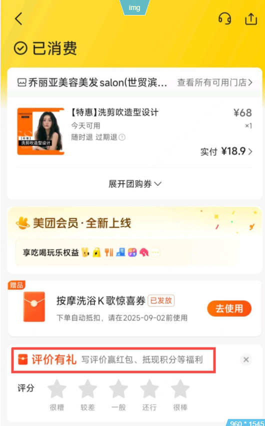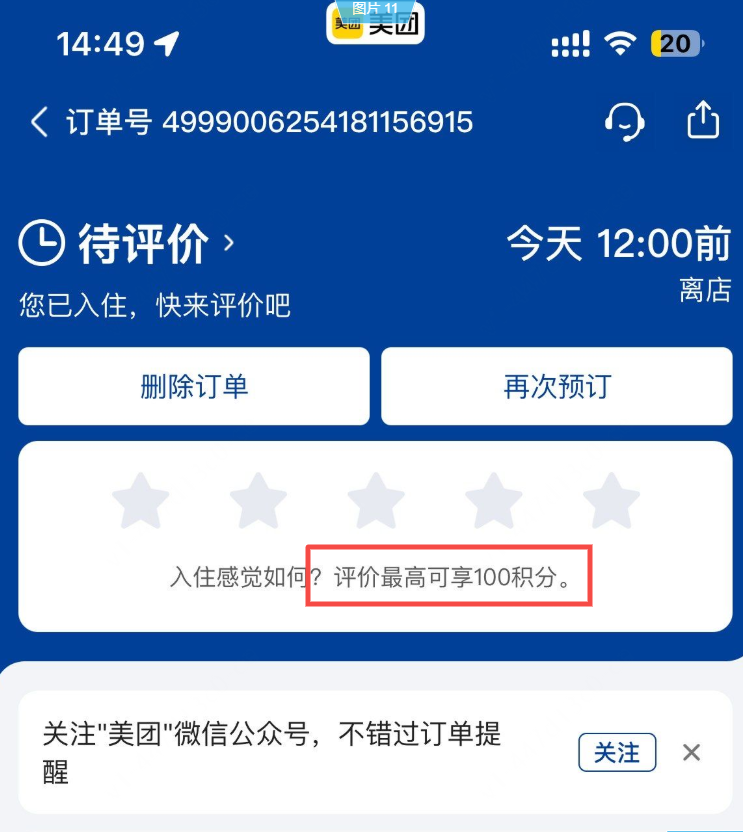

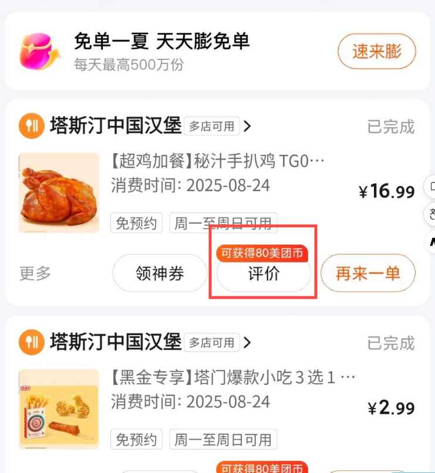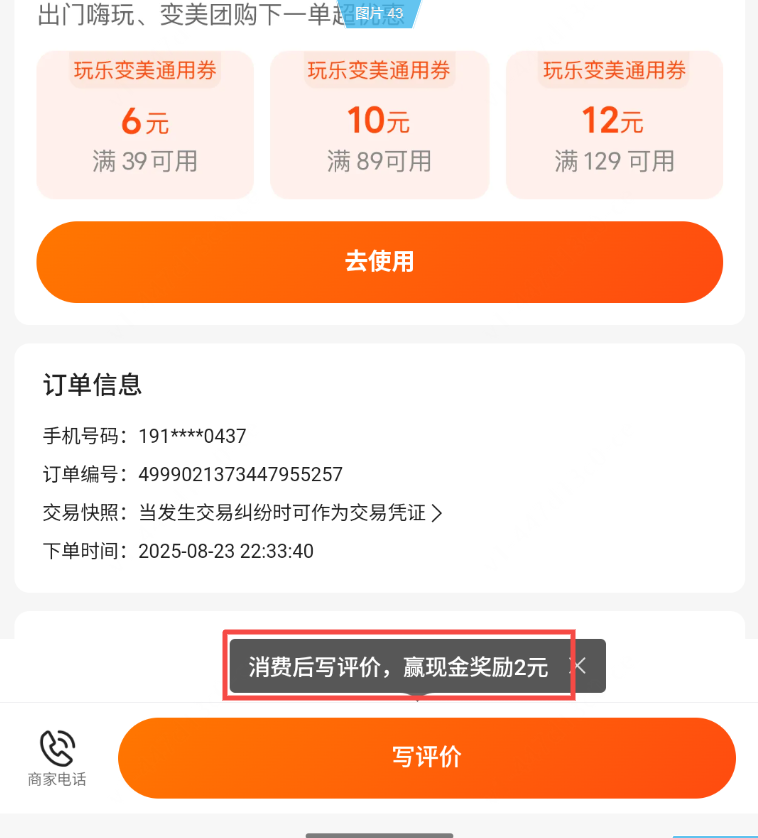

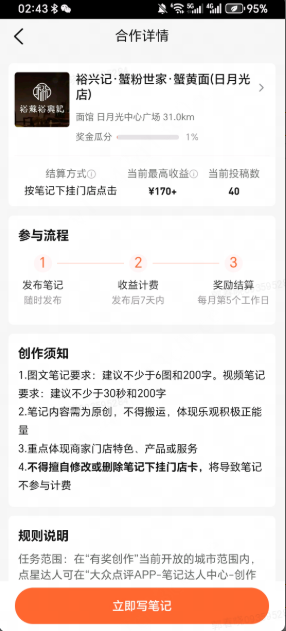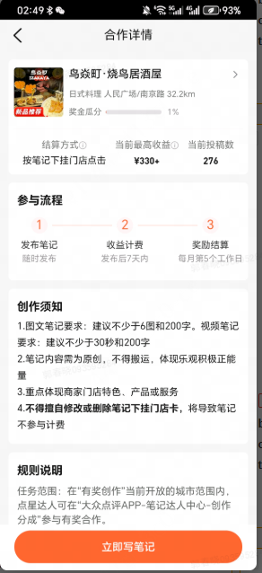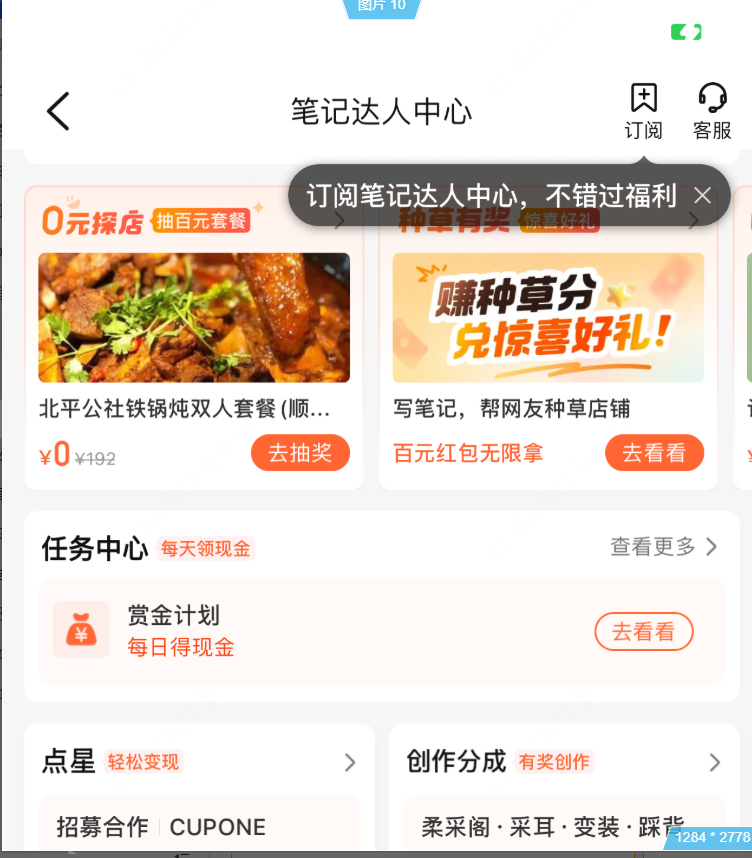

【图片未选入本次 500 张同步】【图片未选入本次 500 张同步】

</li>
<li id="b-fc31993cfb6c4084bc1d5fe01c738fb6">

其他三方平台官方页面发起的活动

案例

<ul id="b-0aab003072964174a22aa6e2773582d9">
<li id="b-eefedf7300cb429dba1431c39e52e3b6">抖音</li>
</ul>

【图片未选入本次 500 张同步】【图片未选入本次 500 张同步】

</li>
</ol>
</td>
</tr>
<tr id="b-e1a71857aa2342369122cdc1852fc2ff">
<td id="b-c46f00621a644fe9bbad6b86bb911b30">

</td>
<td id="b-fd132aa0e71e407991eb886d6713ada6">

</td>
<td id="b-c2fb657bfc0e462e9a6aaa7c6a5cba12" style="vertical-align:top">

<strong>打标</strong>

【图/视/文/音】

<ol id="b-0f7518a8d2fa42479d9282ddb59e26cb">
<li id="b-ea26ab4638004e7aba38575b928f9ede">

出现明示要求用户<strong>修改评价</strong>的

<strong>修改评价</strong>

修改评价内容、评价星级、评价分类等

</li>
<li id="b-bc603ad1285a43bd90f619bcfe623cdd">

用暗示话术明确引导用户修改评价：提及<strong>点评行为</strong>并关联<strong>暗示话术</strong>

<strong>点评行为（可泛化，适用于定义2）</strong>

差评、评价、反馈、诉求、星级

<strong>暗示话术（可泛化，适用于定义2）</strong>

给个机会、高抬贵手、帮帮忙吧、沟通一下、商量一下、处理一下

</li>
</ol>

<strong>不打标</strong>

<ol id="b-83bdb3530ecf4486b9931210ce329c29">
<li id="b-4180106b6e804251837323bd691f2a01">

用户自行修改评价

</li>
<li id="b-0a0d279e658d4006ad663a7ff5819c16">

用户反馈商家有要求修改评价行为

</li>
<li id="b-4470462e7d1f4f938b26d6039058774f">

要求删除个人形象照片的内容

</li>
<li id="b-f4d418aa9c524613bfc561a8d1d65eb7">

<strong>无需执行type：10447、20358、40035</strong>

<strong>审核无需执行队列</strong>

<strong>机审质检：</strong>

机审质检SJ_点评定制专审 机审质检SJ_交互信息_10447生态

机审质检DX_交互信息_10447_生态

机审质检DX_交互信息_10447

<strong>人审（及对应质检）：</strong>

【生态】25min通用审核点评-定制专审21601

【生态】25min通用审核-点评-星级用户定制专审(id: 24437)

</li>
</ol>
</td>
<td id="b-11236c65e08a4b6ebd3630e3b53dd73f" style="background-color:rgb(255, 255, 255);vertical-align:top">
<ol id="b-2082181d9e8841c3b09f3ab464323162">
<li id="b-e5b205aac48a4a4e81bdf22021cf207c">

出现明示要求用户<strong>修改评价</strong>的

案例

<ul id="b-431da992efc8400daef9a4f0becdde5a">
<li id="b-fc05082270d94e35821b4e9e270508a6">您好，小姐！您看您能不能将您的点评帮忙删除一下，因为我们公司对大众点评比较重视，处罚也比较重</li>
<li id="b-fa25590f35ad40e2943cb0c078989d3b">您看这样行不，您改下评价回头你截屏短信，我在帮阿姨免费剪一次，不收费用</li>
<li id="b-142e8d89c0224297b32eaf38fc61635c">麻烦把这条评论的照片删除一下</li>
<li id="b-347f0aab9910497caeacac5285de226f">就是你刚才点评的那个颜色造型把星星改成4星或者5星行吗</li>
<li id="b-403d1572b0cd40c7995c7111be81ef45">您好，能帮忙把星级加满嘛</li>
<li id="b-43a353ab1e0e478b89fa0d6b90367cd4">3.5属于差评，您帮帮忙吧，稍微调整一下行吗</li>
</ul>
<ul id="b-a2e74368a91746a5b5cd2a48eb62d063">
<li id="b-812212b73ae64c11ad695fd232af10df">您好帅哥，让您当时不愉快的体验非常抱歉！这么晚还想发信息给您，想让您手下留情，<strong>差评</strong>对餐饮的打击太大了，现在餐饮也特别难做，一个差评主管是有责任的，罚单就半个月工资了，😮‍💨出来打工赚钱补贴家用实在没办法，现在只能求您<strong>手下留情</strong>，您大人不计小人过吧😭</li>
<li id="b-581402ee766546feb2d3bb69ff168bda">非常不好意思，这边方便电话沟通一下吗，就是11月2日给我们一个<strong>差评</strong>，我们的口味可能没有达到你的要求。再次给你道个歉，你这边方便我们电话<strong>沟通一下</strong>吗？</li>
</ul>

</li>
</ol>
</td>
<td id="b-14ccb11108164ecb9ace8b2501ff92cc">

</td>
<td id="b-b5f09e38349b425eb3f6812ca1112ed6" style="vertical-align:top">
<ol id="b-da6599f11ec742b5af3a696eab37a6ba">
<li id="b-c76dd4085098423da403bc7f40571e85">

用户自行修改评价

能体谅你们的辛苦，评价我已经删除了，就是希望之后管理上能够多加注意

</li>
<li id="b-79492d5e871646c1a29c8f9938a683c7">

用户反馈商家有要求修改评价行为

<ul id="b-b48ac46db35240788c1ee46655833b24">
<li id="b-05c0fb5101914c8fa274dbfa720e73b5">总结四个字，什！么！玩！意！ 我的点评还在审核期，这家店已经🉐知消息，然后又同意是免费🆓体验！<strong>条件是删除差评</strong>，然后一而再再而三地打电话，各种换人，最后是一位自称投资人的工作人，态度强硬，要求删除，我答应修改评论。然后就是各种短信轰炸，我自己的工作忙到半夜，我还必须放下所有事情，先帮你们修改差评，我没有这个义务！</li>
</ul>
</li>
<li id="b-166ddf164e3f49ecbe448daeb997130c">

要求删除个人形象照片的内容

<ul id="b-e919eb86d11346e6bd683dc81a8d4c17">
<li id="b-fef5a3b9c73f4d978662f9914aba7117">您好，您那个往复餐厅的评价不小心拍到我了，能麻烦您删除那张图吗？</li>
</ul>
<ul id="b-a4f58dff095b4ea682fb16eeed99212d">
<li id="b-8e162a6212394683abca75895263b17f">你好~[撇嘴]看到你在face too face 带图点评！图1我男朋友入境了[惊讶][惊讶]可不可删除了！万分感谢！</li>
</ul>
</li>
<li id="b-69abfabfc5884fe4bb4f7d175fb5f70a">

非暗示话术引导用户修改评价

案例

<ul id="b-6614700664034444a17304b881b0416a">
<li id="b-1ba62d2418d8458196cac645c248e4b7">蟹蟹亲的好评，看到亲的表扬，心里暖暖的，您的认可就是我们继续努力的动力，希望有机会为亲亲再次服务～</li>
<li id="b-6bd034392261418987a8ab54b7586c21">亲亲，感谢您对我们店铺做出的评价，您的认可是我们一直追求的目标，我们会继续做的更好，有什么问题可以联系我们在线的客服哦，佗王大药房祝您生活愉快~</li>
<li id="b-299eea21cf664270ac9e9a5c4d0640ea">非常抱歉，我们一定改善，下次一定让您满意 请再给我们一次机会，谢谢您的反馈，祝您生活愉快！</li>
<li id="b-d924ec60591a46f9820e4772a1e6aa0a">您好，感谢您的反馈，我们非常抱歉您对辣度的不满意。对于宽粉未放的问题，我们会加强员工培训，确保每份订单都准确无误。再次为给您带来的不便表示歉意，希望您能给我们改正的机会。</li>
<li id="b-240d0becdd434903953d9798c9f969cf">真的很不好意思，我们煮的时间过长导致了不愉快的体验。对于给您带来的苦味，我们深感歉意。我们一定会加强品控，确保每一份外卖都能达到最佳的口感。感谢您的反馈，希望您能再给我们一次机会，我们会做得更好。</li>
<li id="b-c796b14dabd846d5be2d9cd11700ec8e">您好，感谢您的反馈，我们非常抱歉您对菜品的口味感到失望。对于年糕的评价，我们感到欣慰。我们一直在努力提升菜品质量，希望未来有机会能改善并提供更满意的体验给您。感谢您指出的问题，我们会认真考虑并改进。</li>
</ul>

</li>
</ol>
</td>
</tr>
<tr id="b-6b0102db7d754416983c6167241650ff">
<td id="b-8815436dc1d4470a8c08c4304d3f691a">

</td>
<td id="b-d889463f8d68422f9a7a9d5157bd60b8" style="background-color:rgb(250, 225, 235);vertical-align:top">
<h4 id="b-ff4e5bafe399470997749cda0cb5bc9d" style="text-align:center">虚假活动</h4>
</td>
<td id="b-6473c83ca9bd4885a89b30b25a0af2ab">

</td>
<td id="b-6a56b19f65b842079d42794703f46f14" style="vertical-align:top">

<strong>打标</strong>

【图/视/文/音】

<ol id="b-cfdee8c2123d489aa73fa56b8cd112e2">
<li id="b-1d766956c3bc4aa5878273b2c705296a">

出现非官方渠道发布的招募达人信息

</li>
</ol>
</td>
<td id="b-e53ce788ec3c477c8a0069d6239245de">
<ol id="b-20be6e96d92143b982539e839d4ef64a">
<li id="b-c1da820863b24c7fa8db901135fda0de">出现非官方渠道发布的招募达人信息</li>
</ol>
<ul id="b-befd67c3d1e44836bcd59e94dd24df95">
<li id="b-01edc51ea5b941d2a5ba9b583845cd87">大众点评即将上线一个功能，接受达人点评和到店直播，会赚取佣金，20-20000不等。我们不收任何费用，我们只收取商家服务费用。我们现在也是在大量招募达人。希望不要误会我们是骗子[呲牙][呲牙]</li>
</ul>
</td>
<td id="b-29909fc1b9554d9bac5664044c63601d">

</td>
<td id="b-6e0ee420f3e145e4b6ed3457acc2b779" style="vertical-align:top">

</td>
</tr>
</table>

